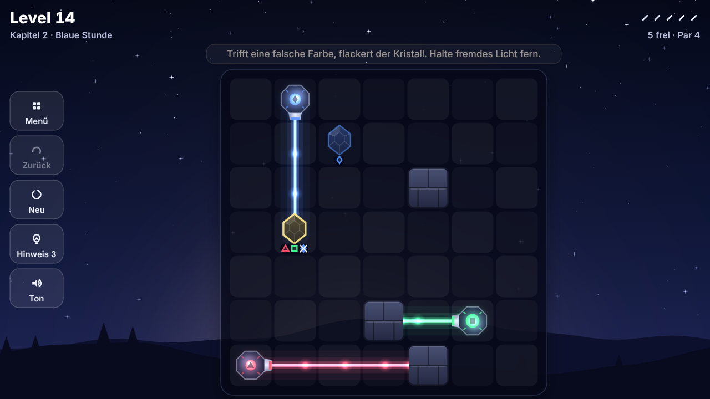
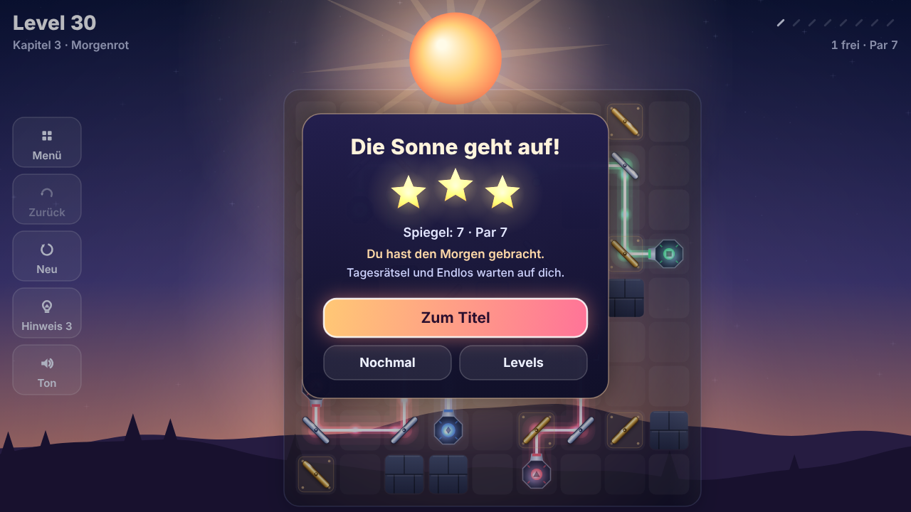

# New Dawn – A light puzzle

[Deutsch](README.md) · **English**

Guide colored beams of light through the night with mirrors, mix red, green and blue,
and make every crystal shine. Each chapter gets a little brighter, until the sun rises.



- **Smart:** real logic puzzles. A built-in solver proves for every level that it can be solved
  and that **no solution uses fewer mirrors** than par.
- **Offline:** a single HTML file, no install, no internet, no ads.
  Your progress is saved in the browser.
- **Easy to code:** plain JavaScript without libraries. Every tuning value is in `config.js`,
  and each level is one line.
- **Beautiful:** glowing beams with flowing sparks of light, faceted crystals, a starry sky,
  hills and a sunrise. Everything is drawn in code.
- **German and English:** the game picks your browser's language; switch any time with the
  `DE | EN` button on the title screen and in the menu (level select), or with the `L` key.

## Play

| How | What to do |
|---|---|
| **On a computer** | Double-click `index.html` (it opens in your browser). `config.js` must be next to it. |
| **One file for anywhere** | Download `dist/new-dawn.html` and open it: phone, tablet, USB stick, no internet needed. |
| **As a website** | In GitHub go to *Settings → Pages*, choose "Deploy from a branch", then the branch and the folder `/ (root)`. The game is then playable at your Pages address. |

## How to play

1. Every **lens** shoots a colored beam.
2. **Tap** an empty cell: a mirror `/` appears. Tap again to turn it into `\`,
   a third tap removes it (right-click removes it at once).
3. Mirrors are **two-sided**: they turn every beam that hits them, including other colors.
4. Every **crystal** wants exactly its own color:
   yellow = red + green · magenta = red + blue · cyan = green + blue · white = all three.
   The markers under a crystal show which colors it needs and which already arrive;
   a wrong color appears crossed out.
5. **Gold mirrors** are fixed in place, **walls** block, **colored glass** lets only its own color through.
6. You have **par + 1 mirrors**. Three stars for solving at par without a hint.
   You cannot lose: undo and reset are always free.

Color-blind? Each primary color also has a shape: red ▲ triangle, green ■ square, blue ◆ diamond.

**Keyboard:** arrow keys + space place and turn · `Delete`, `Backspace` or `X` remove ·
`Z` or `U` undo · `R` reset · `H` hint · `M` sound · `L` language (title and level screens) · `Esc` menu.
This works on German and English keyboards.

## What's inside

- **30 levels in 3 chapters** (Midnight, Blue Hour, Daybreak). Each chapter brings new ideas:
  crossing beams, fixed mirrors, color mixing, wrong colors, colored glass and white light.
  All levels at a glance (German): [docs/LEVELS.md](docs/LEVELS.md).
- **Daily puzzle:** a new one every day, easy on Monday, hard on Sunday, never harder than your progress
  (at least the rules of level 4).
- **Endless:** puzzle after puzzle, getting harder up to the rules of level 30; from puzzle 13 on it stays there.
- Stars, hints, unlimited undo, synth sounds (Web Audio), progress saved in the browser.



## Build on it

```
index.html             the whole game (sections marked with // ----)
config.js              every tuning value: spare mirrors, hints, glow, speed, generator …
dist/new-dawn.html     the game as one file (built, do not edit by hand)
tools/build-single.sh  builds dist/new-dawn.html
design/game-brief.md   the game brief: idea, first minute, challenge, features (German)
docs/ARCHITEKTUR.md    how light, generator, solver, saving and testing work (German)
docs/LEVELS.md         all 30 levels and the fields of a level line (German)
CHANGELOG.md           what changed when (German)
```

- **Change or add a level:** `index.html` holds the table `LEVELS`.
  A line like `{ w: 7, h: 7, crys: [YEL, BLU], turns: [1, 2], walls: 3, minPar: 4 }`
  sets the board size, crystals, turns per beam, walls and the minimum number of mirrors.
  The generator does the rest (positions, solution, proof).
- **Change the texts or add a language:** every text the player sees is in the table `STR` in
  `index.html`, one block per language (`de`, `en`). A new language is one more block with the same keys.
- **Tune values:** open `config.js`, change a number, reload the page.
- **A different set of levels:** change `seed` in `config.js` and 30 new levels appear.
- **Testing:** `index.html?level=12` starts level 12 directly, `?lang=en` or `?lang=de` picks the
  language, `?fresh=1` plays without saved progress, `?scene=figures` shows every game piece.
- **Rebuild the single file** after every change to `index.html` or `config.js`:

```bash
sh tools/build-single.sh
```

## How it was made

Built with the `/prototype` flow of
[Claude Code Game Studios](https://github.com/donchitos/claude-code-game-studios):
brief → build → automatic check in the browser. Then four independent reviewers
(logic, puzzle quality, layout on eight screen sizes, game feel) tested the game, and skeptics
re-checked every finding before it went in. Details (German) in [CHANGELOG.md](CHANGELOG.md).
