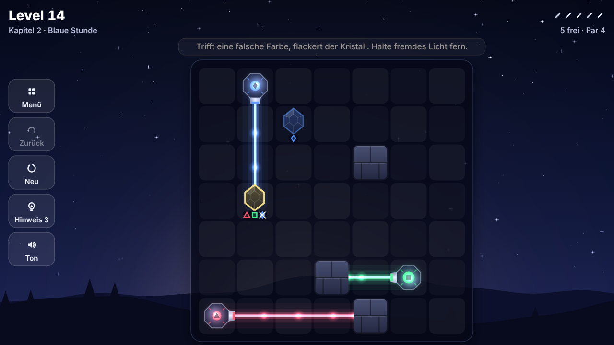
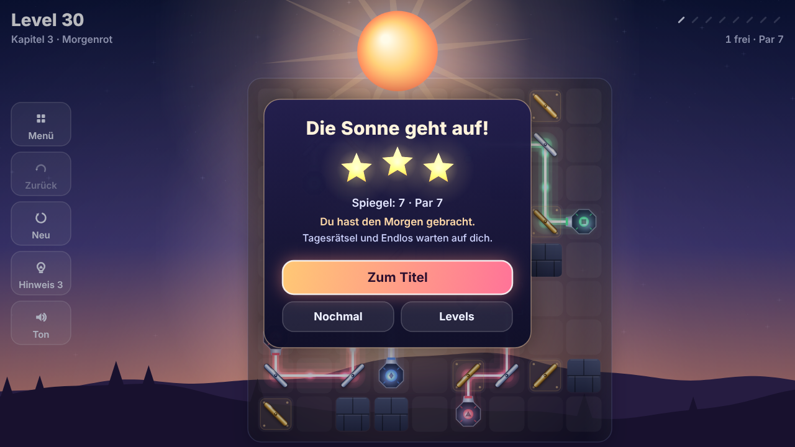

# New Dawn – Ein Lichträtsel

Lenke farbige Lichtstrahlen mit Spiegeln durch die Nacht, mische Rot, Grün und Blau
und bring jeden Kristall zum Leuchten. Mit jedem Kapitel wird es heller, bis die
Sonne aufgeht.



- **Smart:** echte Logikrätsel. Ein eingebauter Löser beweist für jedes Level, dass es lösbar ist
  und dass es **keine Lösung mit weniger Spiegeln** als Par gibt.
- **Offline:** eine einzige HTML-Datei, keine Installation, kein Internet, keine Werbung.
  Der Fortschritt wird im Browser gespeichert.
- **Einfach codebar:** reines JavaScript ohne Bibliotheken. Alle Stellschrauben stehen in
  `config.js`, jedes Level ist eine Zeile.
- **Schön:** leuchtende Strahlen mit fließenden Lichtfunken, facettierte Kristalle,
  Sternenhimmel, Hügel und ein Sonnenaufgang. Alles wird im Code gezeichnet.

## Spielen

| Wie | Was tun |
|---|---|
| **Am Computer** | `index.html` doppelklicken (öffnet im Browser). `config.js` muss daneben liegen. |
| **Eine Datei für überall** | `dist/new-dawn.html` herunterladen und öffnen: Handy, Tablet, USB-Stick, ganz ohne Internet. |
| **Als Webseite** | In GitHub unter *Settings → Pages* „Deploy from a branch“ wählen, den Branch und den Ordner `/ (root)` einstellen. Dann ist das Spiel unter deiner Pages-Adresse spielbar. |

## So geht's

1. Jede **Linse** schießt einen farbigen Strahl.
2. **Tippe** auf ein leeres Feld: Es erscheint ein Spiegel `/`. Nochmal tippen dreht ihn zu `\`,
   ein dritter Tipp entfernt ihn (Rechtsklick entfernt sofort).
3. Spiegel sind **beidseitig**: Sie lenken jeden Strahl ab, der sie trifft, auch fremde.
4. Jeder **Kristall** will genau seine Farbe:
   Gelb = Rot + Grün · Magenta = Rot + Blau · Cyan = Grün + Blau · Weiß = alle drei.
   Die Marker unter dem Kristall zeigen, welche Farben er braucht und welche schon ankommen;
   eine falsche Farbe erscheint durchgestrichen.
5. **Goldene Spiegel** sind fest verbaut, **Mauern** blockieren, **Farbglas** lässt nur seine Farbe durch.
6. Du hast **Par + 1 Spiegel**. Drei Sterne gibt es mit Par und ohne Hinweis.
   Verlieren kannst du nicht: Rückgängig und Neustart sind jederzeit frei.

Farbenblind? Jede Grundfarbe hat zusätzlich eine Form: Rot ▲ Dreieck, Grün ■ Quadrat, Blau ◆ Raute.

**Tastatur:** Pfeiltasten + Leertaste setzen und drehen · `Entf`, `Rücktaste` oder `X` entfernen ·
`Z` oder `U` zurück · `R` neu · `H` Hinweis · `M` Ton · `Esc` Menü.
Das gilt für deutsche und englische Tastaturen.

## Inhalt

- **30 Level in 3 Kapiteln** (Mitternacht, Blaue Stunde, Morgenrot). Jedes Kapitel bringt neue Ideen:
  Kreuzungen, feste Spiegel, Farbmischung, falsche Farben, Farbglas und weißes Licht.
  Alle Level im Überblick: [docs/LEVELS.md](docs/LEVELS.md).
- **Tagesrätsel:** jeden Tag ein neues, montags leicht, sonntags schwer, nie schwerer als dein Fortschritt
  (mindestens mit den Regeln von Level 4).
- **Endlos:** Rätsel um Rätsel, schwerer bis zu den Regeln von Level 30; ab dem 13. Rätsel bleibt es dabei.
- Sterne, Hinweise, Rückgängig ohne Limit, Synth-Klänge (Web Audio), Spielstand im Browser.



## Selbst weiterbauen

```
index.html             das ganze Spiel (Abschnitte mit // ---- markiert)
config.js              alle Stellschrauben: Ersatzspiegel, Hinweise, Glanz, Tempo, Generator …
dist/new-dawn.html     das Spiel als eine Datei (gebaut, nicht von Hand ändern)
tools/build-single.sh  baut dist/new-dawn.html
design/game-brief.md   der Spiel-Brief: Idee, erste Minute, Herausforderung, Features
docs/ARCHITEKTUR.md    wie Licht, Generator, Löser, Speichern und Testen funktionieren
docs/LEVELS.md         alle 30 Level und die Felder einer Level-Zeile
CHANGELOG.md           was sich wann geändert hat
```

- **Ein Level ändern oder hinzufügen:** In `index.html` steht die Tabelle `LEVELS`.
  Eine Zeile wie `{ w: 7, h: 7, crys: [YEL, BLU], turns: [1, 2], walls: 3, minPar: 4 }`
  beschreibt Brettgröße, Kristalle, Knicke pro Strahl, Mauern und die Mindestzahl Spiegel.
  Den Rest (Position, Lösung, Beweis) macht der Generator. Alle Felder: [docs/LEVELS.md](docs/LEVELS.md).
- **Werte drehen:** `config.js` öffnen, Zahl ändern, Seite neu laden.
- **Andere Level-Welt:** `seed` in `config.js` ändern, dann entstehen 30 neue Level.
- **Testen:** `index.html?level=12` startet direkt Level 12, `?fresh=1` spielt ohne
  gespeicherten Fortschritt, `?scene=figures` zeigt alle Spielfiguren. Mehr in
  [docs/ARCHITEKTUR.md](docs/ARCHITEKTUR.md#testen).
- **Einzeldatei neu bauen** nach jeder Änderung an `index.html` oder `config.js`:

```bash
sh tools/build-single.sh
```

## Entstehung

Gebaut nach dem `/prototype`-Ablauf von
[Claude Code Game Studios](https://github.com/donchitos/claude-code-game-studios):
Brief → Build → automatischer Check im Browser. Danach haben vier unabhängige Prüfer
(Logik, Rätselqualität, Layout auf acht Bildschirmgrößen, Spielgefühl) das Spiel getestet
und Skeptiker jeden Befund nachgeprüft, bevor er eingebaut wurde. Details in [CHANGELOG.md](CHANGELOG.md).
